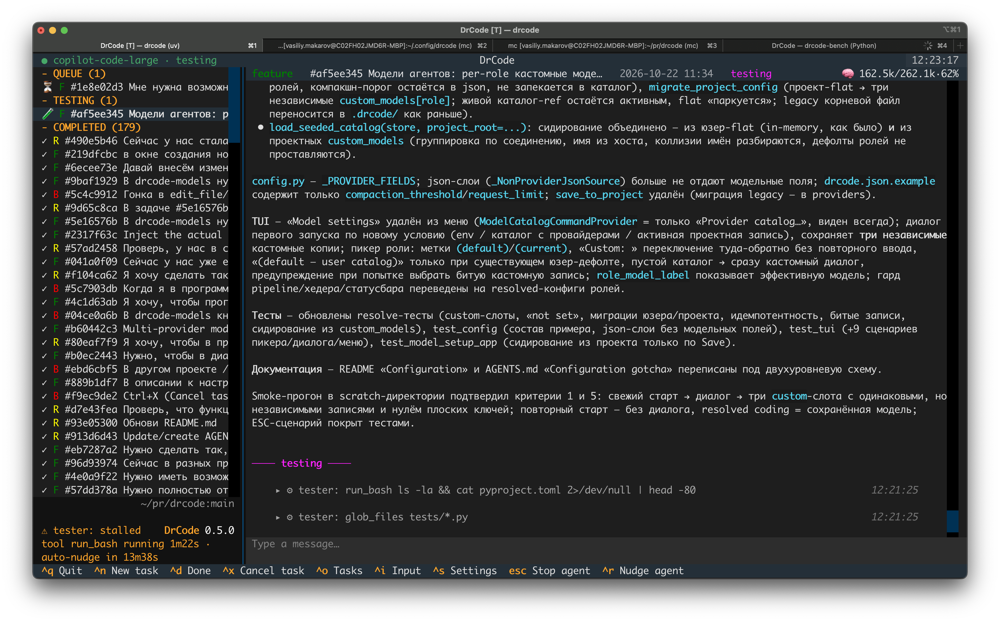

# drcode

Console AI coding agent (pydantic-ai + textual), inspired by opencode.
The center is not a chat session, but a **task** (feature request, bug report, or research question):

- one task is *active* at a time — work on it looks like a dialog that starts with the task description;
- while the agent works, you can create new tasks and put them in a **queue**;
- when the active task is marked done, the next queued task starts **automatically**;
- you can browse completed tasks and write into one — it re-enters the queue (or becomes active immediately if nothing is running).

## Appearance



## Install & run

From source (development):

```bash
uv sync
uv run drcode
```

Globally available from any project directory:

```bash
uv tool install .        # installs the `drcode` command into ~/.local/bin
# or, equivalently, with pipx:
pipx install .
# or plain pip (preferably into the user environment):
pip install .
```

Update after code changes: `uv tool install . --force` (pipx: `pipx upgrade .` or reinstall).
Uninstall: `uv tool uninstall drcode`.

The TUI operates on the **current directory** (`Path.cwd()`).

Voice I/O (push-to-talk dictation and spoken announcements, see below) is
built in — the `sounddevice` dependency ships with the package; its wheels
bundle PortAudio (on Linux install `libportaudio2`).

## Standalone binary

A self-contained bundle that ships its own Python interpreter and all
dependencies — no Python installation and no library versions required on the
target machine. Build it on each target OS/architecture (cross-compilation is
not supported):

```bash
bash scripts/build-binary.sh
# → dist/drcode/            (onedir bundle, run it as dist/drcode/drcode)
# → dist/drcode-<version>-<os>-<arch>.tar.gz   (distributable archive)
```

Install from a release archive:

```bash
tar -xzf drcode-<version>-<os>-<arch>.tar.gz
./drcode/drcode --version
```

The build produces an **onedir** bundle rather than a single-file executable
on purpose: a one-file PyInstaller binary unpacks its whole payload into a
fresh temp directory on every start, and on hardened macOS setups each
freshly written binary/dylib is then re-verified by the OS (hundreds of ms
per file), which made even `drcode --version` take 10+ seconds. With onedir
the payload is written once at unpack time and subsequent starts are fast
(~0.4s). Set `DRCODE_ONEFILE=1` to build a legacy single-file executable
anyway.

PyInstaller is provisioned automatically via the `build` dependency group
(`uv sync --group build --extra voice`). The bundle carries the voice
features on every platform: macOS/Windows via the PortAudio binary shipped
in the `sounddevice` wheel, Linux via an ALSA-only `libportaudio.so.2`
built from source during the build (`scripts/fetch-portaudio.sh`; needs the
ALSA headers — Debian/Ubuntu `libasound2-dev`). The binary reads the same
configuration (env vars,
`~/.config/drcode/drcode.json`, per-project `.env` / `.drcode/drcode.json`) as the
installed package.

## Configuration

Model selection is two-level:

- **User level** (`~/.config/drcode/`) — the provider/model catalog `models.json`, edited via Settings → **Provider catalog…** (or the standalone `drcode-models` utility): OpenAI-compatible endpoints with their API keys, auto-discovered or hand-entered models (with context sizes and optional per-model compaction limits) and per-role defaults. The catalog is shared by every project.
- **Project level** (`.drcode/drcode.json`) — a model per agent role (coding / research / tester / compaction), chosen in Settings ("Coding model: …" etc.) either from the catalog or as a **custom model** (a free-form connection stored under `custom_models[role]`, one independent entry per role). Switching a role to a catalog model parks its custom model — the picker offers it back as "Custom: <model-id>" without re-entering anything. The research role needs no explicit pick: when nothing is selected for it anywhere, research tasks transparently run on the coding model — pin a dedicated research model only if you want a cheaper one for the read-heavy analysis load.

A plain env override still wins over both levels (or a `.env` file in the project root):

```bash
DRCODE_MODEL=gpt-4o
DRCODE_BASE_URL=https://api.openai.com/v1   # or your own endpoint
DRCODE_API_KEY=sk-...
DRCODE_MAX_CONTEXT_TOKENS=200000            # context window of the model
DRCODE_MAX_TOKENS=8192                      # per-response output cap
DRCODE_COMPACTION_THRESHOLD=80              # % fill at which history is compacted
```

Non-provider settings (`DRCODE_COMPACTION_THRESHOLD`, `DRCODE_REQUEST_LIMIT`) may also live in `~/.config/drcode/drcode.json` or `<project>/.drcode/drcode.json` (env > project json > user json > defaults).

If nothing anywhere provides a model (no env vars, an empty catalog and no project selection), the TUI opens a **first-start setup dialog**: model and endpoint are required, the API key and context size are optional; Save probes the endpoint live (the verified availability endpoint is cached for cheaper later checks) and stores the model as a custom model for the coding, tester and compaction roles into `<project>/.drcode/drcode.json` (research keeps its coding fallback). ESC skips it — the app stays usable without a model (tasks can be created and browsed, nothing runs). Projects/configs from older versions with flat model keys in their drcode.json files are migrated automatically on startup (user flat config → catalog with all role defaults; project flat config → three per-role custom models), and the flat keys are then ignored.

Without a configured model every message fails with "Model is not configured". If the project root contains an **AGENTS.md**, its content is appended to the agent's instructions — and if it doesn't, the app offers on startup to create one with a pre-filled research task (the same one the Settings palette's "Update/create AGENTS.md" entry runs).

## Task pipeline

Tasks flow through a pipeline, mirrored by the sidebar: QUEUE → NEEDS CLARIFICATION → ACTIVE → TESTING → COMPLETED, plus ON HOLD.

- **Kinds** — every task is a `feature` (F), `bug` (B) or `research` (R). Each kind has a dedicated system prompt: feature tasks are encouraged to refactor and restructure, bug tasks must keep changes minimal, research tasks answer questions or update docs. A research agent can also file new tasks on the user's behalf (`create_bug_report` / `create_feature_request`, placed by the ordinary queue rules) and commit its documentation edits (`git_commit_docs`).
- **Todo checklist** — feature agents plan multi-step work with `todo_create` / `todo_update` (registered for feature tasks only — bug tasks, research tasks and the tester get no todo tools, which structurally prevents the one-item-list-on-a-small-bugfix anti-pattern; a checklist requires 3+ items). The list lives on the task, is shown as a read-only panel between the chat log and the input, and is re-injected into the model context on every activation and after compaction, so an abandoned stale plan cannot go unnoticed.
- **Auto-completion** — when the agent finishes a run with nothing pending, the task moves on by itself (as if you pressed done). Documentation tasks skip testing and complete right away.
- **Tester agent** — after every completed task a separate QA agent verifies the project: it detects available linters/tests/build commands, runs them, and labels the task ✅ passed or ❌ failed (only the tester can complete a task after testing). It receives the whole conversation — the original task plus any mid-flight clarifications — not just the first message. On success, in a git repository, it stages the changes, commits them with a message paraphrasing the original task (appending `Fixes #N` for tasks imported from GitHub issues) and best-effort pushes them to the remote. On failure it creates a **bug report task** at the head of the queue. Failed tester runs are retried automatically with capped exponential backoff.
- **Context compaction** — when the conversation fill reaches `DRCODE_COMPACTION_THRESHOLD` (80 % of the context window by default), a tool-less summarizer rewrites the transcript into a structured summary before the next turn; the original user prompts stay verbatim, so long-running tasks never hit the context ceiling.
- **Pipeline gate** — while any task is awaiting verification, no new development starts: testing always has priority over the queue.
- **Parallel development slots** — with per-task worktree isolation on (`task_isolation: worktree` in `.drcode/settings.json`), several independent tasks develop at once, each in its own worktree and on its own `drcode/<id>` branch. The limit (`parallel_tasks`, 1–4, default 1 — also in `.drcode/settings.json`, changeable from the Settings palette) fills from the queue automatically; lowering it never kills running tasks, it only stops new promotions until the slots drain. The tester stays **single** by design: testing never occupies a development slot, and while any task is awaiting verification nothing new starts — concurrent tasks each run their own linters/tests, so pick slots to match what your machine (and the projects' ports/services) can take. Sibling tasks sharing a dependency still edit different worktrees, but if they touch the same files their merges can conflict — that's for you (or your `on_accepted` hook) to sort out. Without worktree isolation the setting is dormant (behaves as 1, with a warning at startup).
- **Clarifying questions** — the agent can pause a task with a question (optionally with suggested answers rendered as clickable options). An answered task re-enters the pipeline at the head of the queue.
- **Interrupted work is never lost** — aborting (Esc) or an agent error leaves the partial work in the transcript; the next activation resumes the attempt without re-sending the prompt. A task whose run crashed is demoted to the queue and retried, while a dead gateway can't loop the whole queue through the error.
- **Transient network failures are retried in place** — a run that dies with a transport error (connection refused, timeout, DNS failure) or HTTP 429 rate limiting is retried without changing the task's status, after a 5 s doubling backoff capped at 60 s, at most 5 times; the retry budget resets after any successful model call. Only when the budget is exhausted does the run fall to the ordinary failure path (requeue + session exclusion).
- **Stall watchdog** — a run that stops showing any sign of life (no stream deltas, no tool events) is aborted and restarted automatically after the configured stall limit (15/30 min, 1/2 hours, or never; 30 min by default, per project in `.drcode/settings.json`): the agent resumes via a continuation turn, the tester gets a fresh round. With parallel slots every running task has its own deadline — a nudge touches only the stalled run, healthy siblings keep working. The same nudge is available manually with `ctrl+r` on an active or testing task. Every automatic nudge is logged into the task's service events.
- **Restart-safe** — on startup, stale active tasks are re-queued, and tasks stuck in TESTING are re-tested first, before any queued task is taken into development.
- **Failed-queue rescue** — a task whose run crashed (network outage, model error) is excluded from promotion for the rest of the session, so one broken task can't loop the queue. But when *every* queued task is failed and nothing is running, the exclusion is forcibly lifted and the backlog re-runs (with capped exponential backoff between rescue rounds, reset by any successful model call) — the queue keeps working instead of dead-ending until restart.
- **Queue ordering** — bug reports always come first (newest at the head, so tester-created bugs are picked up immediately); answered clarifications follow, then creation order; tasks blocked by dependencies sink below every runnable one. The kind of a still-queued task can be changed: re-typing to bug moves it to the head, to feature — to the tail.
- **Dependencies** — a task can wait for other tasks: in the new-task form press `ctrl+g` and enter comma-separated task ids (or use the Settings palette's "Add/Remove dependency" entries for the viewed queued/held task; removing a blocking dependency is the force-start). A dependency is satisfied only when it is **completed AND merged**: its task reached COMPLETED and — when per-task worktree isolation is on — its `drcode/<id>` branch is gone or fully merged into your base branch. The check is dynamic (fresh git state at every promotion attempt, re-polled by a 30 s tick even while the pipeline is otherwise idle): merging a dependency by hand unblocks the dependents immediately, and a deleted dependency is judged by its surviving branch. Blocked tasks show a 🔒 marker in the sidebar; the task bar lists each dependency with its state. Without worktree isolation (the default) there is nothing to merge — the gate degenerates to "COMPLETED"; the merge guarantee only means something under isolation (or when your workflow hooks merge).
- **Hold / delete / cancel** — park a queued task out of the backlog (input keeps accumulating while held, and an unanswered clarification is preserved), delete a held task entirely, or cancel a task (queued or already in TESTING): pending input is dropped and it completes immediately, skipping the tester.
- **Auto-cleanup** — completed tasks older than the retention period are deleted at startup. The setting (7/30/90 days or never) is per project, stored in `.drcode/settings.json`.

## Custom team workflow

A team can give the pipeline its own branching / merge / review process — including an **external code review** that can send a task back for rework — without changing the UI and without new task statuses. The workflow is enabled by the mere presence of the files (a solo developer without them keeps the default behaviour):

- **`.drcode/git-workflow.md`** — the team's process rules in plain prose: injected into the coding agents' prompts (replacing the built-in "Never commit to git" sentence) and appended to the tester's, so commits/pushes/PRs follow the same rules.
- **`.drcode/workflow.py`** — hard gates: optional Python hooks (`on_task_start`, `on_development_done`, `on_tester_passed`, `on_review`, `on_accepted`) run in an isolated subprocess with a JSON contract. `on_tester_passed` is the unconditional post-verification hook (e.g. `uv tool install . --force` after every PASSED task). `on_review` is the external review: a *reject* re-queues the task with the reviewer's comment (the agent reworks it in the same transcript), an *accept* completes it and runs `on_accepted` (merge the PR, delete the branch), a *pending* verdict releases the pipeline and the verdict is polled later; after 3 consecutive rejects the task is parked on hold for a human. A failing review is fail-closed — the task waits, nothing is waved through.

`.drcode/git-workflow.md`, `.drcode/workflow.py` and `.drcode/drcode.json` are committable (drcode's `.gitignore` management covers only the private state: tasks, settings with secrets, sync bookkeeping). **Security:** `.drcode/workflow.py` is arbitrary code running with your user permissions — never trust it from a repository you did not author. Full format description: [docs/workflow.md](docs/workflow.md).

#### Example: automated dependency chains

drcode itself never merges — but the `on_accepted` hook can. Combined with task dependencies this builds fully automated chains: each task of a chain waits for its predecessor to be **completed and merged**, then starts on a fresh base.

```python
# .drcode/workflow.py — merge each accepted task's branch into the base
# branch (requires the project setting task_isolation: worktree, which
# gives every task its own branch drcode/<task-id>).
import subprocess
from pathlib import Path


def on_accepted(task) -> None:
    branch = task["worktree"]["branch"]     # drcode/<task-id>
    # With isolation on the hook's cwd IS the task's worktree
    # (<project>/.drcode/worktrees/<id>): the main checkout is two
    # levels up.
    project = Path.cwd().parent.parent
    subprocess.run(
        ["git", "-C", str(project), "merge", "--no-ff", "-q", branch],
        check=True,
    )
    # Optional housekeeping once the work is reachable from the base:
    subprocess.run(["git", "-C", str(project), "branch", "-d", branch], check=True)
    return {"text": f"merged {branch} into the base branch"}
```

With this hook, chaining tasks in the form (`ctrl+g`, e.g. `depends on: ab12cd34`) runs them strictly one after another, each merging before the next one is eligible — without the hook, drcode keeps the branches unmerged and reminds you, and you merge by hand whenever you decide the work is ready.

## GitHub Issues integration

drcode can turn a repository's GitHub issues into local tasks automatically. Configure it in the TUI (Settings → "GitHub integration"): enable switch, personal access token (needs repo read access), repository name (a pasted URL is normalized to `owner/repo`), and the sync interval (1/2/4 hours). The first cycle runs shortly after startup, then on schedule.

- Open issues labeled `bug` become local **bug reports**, labeled `enhancement` — **feature requests**.
- Issues labeled `invalid`/`wontfix`, or with neither actionable label, are dismissed: recorded as seen and never reconsidered (an unlabeled issue is picked up if it gets a label later).
- Every imported task carries the issue number; on success the tester appends `Fixes #N` to its commit message so GitHub links the commit back to the issue.
- Very long issue bodies are capped (8000 chars) so one pathological issue can't blow the agent's context.
- Sync results (including failures) are logged to the task history / service events and reported via push notifications.

A sync cycle can also be run headlessly, e.g. from cron: `drcode --git-hub-sync` (see below).

## Push notifications (ntfy.sh)

Per-project push notifications about pipeline events via the public [ntfy.sh](https://ntfy.sh) service — handy for overnight runs. Enable in the TUI (Settings → "Notifications") by picking an unguessable topic and subscribing to it in the ntfy app; messages carry the project folder name in the title.

Reported events:

- task status changes — except those directly caused by the user sitting at the computer (typing, cancelling, holding, pressing Done);
- GitHub sync cycles, with imported/skipped counts;
- settled pipeline states — the queue is empty, or tasks remain but none can be developed (all on hold, awaiting clarification or failed); these are deduplicated, so repeated pipeline re-evaluations never spam identical messages.

Delivery is fire-and-forget and can never stall the UI or an agent run: it happens in a short-lived daemon thread and every failure is swallowed (surfaced as an in-app toast). A notification that couldn't be sent (network down, timeout) is **not lost**: it is persisted in `.drcode/pending_notifications.json` and re-delivered in strict FIFO order, retrying every 15 minutes; a re-sent notification says so, with the moment it originally arose.

## Voice I/O

Speech features over an OpenAI-compatible audio API (`POST /audio/transcriptions` for ASR, `POST /audio/speech` for TTS), configured per project via Settings → **"Voice: …"** (the `sounddevice` audio backend ships with the package; off by default — everything empty = the features are off):

- **Push-to-talk dictation** — `ctrl+b` in a chat input or the new-task form starts the microphone; a second press uploads the recording and inserts the recognized text at the cursor (you edit before sending), `escape` discards it. Everything audio/network runs in worker threads, so the UI never freezes; any failure (no config, no microphone, network) is a readable toast.
- **TTS announcements** — the same events that drive push notifications can be spoken aloud (per-event checkboxes in the dialog: task completed, tester failed, queue became empty). Phrases are synthesized and played one at a time by a background worker with a bounded queue, so a burst of events never stacks up minutes of speech; user-caused events (typing, pressing Done) are never voiced.

Configuration: audio API base URL (the dialog is prefilled with the default gateway), API key — leave it empty to reuse the token of the user-catalog provider whose host matches the audio URL's host —, the ASR and TTS model ids, the speaker voice (`alloy` by default) and the announcement checkboxes. Everything empty = the features are off. The models are stored in `.drcode/settings.json` (`voice_*` fields), not in the model catalog — their ids contain `/`, which would collide with the `<provider>/<model-id>` reference format.

## Headless CLI

One-shot commands without the TUI (the pipeline itself is left to the next interactive start):

```bash
drcode --bug-report DESC          # create a bug report task
drcode --feature-request DESC     # create a feature request task
drcode --git-hub-sync             # run one GitHub Issues sync cycle and exit
```

`--bug-report` / `--feature-request` store the description as the task's first queued message (the title is derived from its first line) and print the created task's id. `--git-hub-sync` prints the cycle summary; exit codes: 0 success, 1 integration not configured, 2 sync failed.

## Tools & safety

The agent has filesystem and shell tools: `read_file`, `write_file`, `edit_file`, `glob_files`, `grep_search`, `run_bash`, `ask_clarifying_question`. Feature agents additionally get the todo checklist tools `todo_create` / `todo_update`; research agents get `create_bug_report`, `create_feature_request` and `git_commit_docs` (which commits only the files the task itself edited and pushes when a remote is configured).

- Reading and searching work anywhere; writing is jailed to the project root and the task's personal scratch directory `/tmp/drcode/<task-id>` (symlink-aware, so `/private/tmp` on macOS counts too) — the rest of `/tmp`, including other tasks' scratch directories, is off-limits. Violations are refused, logged into the task's service-event history and returned to the model as a retry prompt. The scratch directory is created lazily on first use, removed when the task completes or is deleted, and `run_bash` points the child process's `TMPDIR` at it.
- `run_bash` inspects the command first and refuses `rm`/`mv`/`cp` whose path arguments escape the writable area.
- The tester runs with read-only tools; its single write exception is `git_commit`, allowed only after all checks passed.

## TUI

- Streaming chat: assistant answers and model reasoning render live in the chat log (markdown for answers, collapsible gray blocks for reasoning and tool calls, showing the tool name plus its primary argument).
- Sidebar grouped by pipeline stage with per-task markers: kind letter, status icon, verification label, viewed highlight. Sections collapse/expand via click, Enter or Space on the section header.
- Task status bar (top) with kind, id, creation date, status — and the **context fill** in the right corner: tokens and percent of the model's context window (amber near the limit, red at it; the final value is restored from the saved transcript for finished tasks). Clicking the 🧠 token figure opens the **context layout dialog**: the ≈ breakdown of what is actually inside the context slot (system-prompt parts, tool descriptions, transcript parts by kind) for both the development and the latest testing transcript, alongside the exact API-reported figures — last context fill, cache split and cumulative usage. The estimate uses the chars/4 heuristic (no tokenizer — the model is any OpenAI-compatible endpoint), so every estimated figure is marked ≈ and its sum is not normalized to the exact fill.
- Activity indicator: whether the agent/tester is making progress or has gone silent (hung request, long tool), with the currently running tool, its age and a live tok/s streaming-rate figure.
- Model connection status, checked every 30 s; recovery from an outage un-blocks the tasks whose runs died with it. The expandable header shows the endpoint URL, probe latency, the consecutive-failure and network-retry counters, and the session's exact cumulative token usage (`in` / `cache read/write` / `out`, summed over every model call of the session — main agent, tester and compaction summarizer alike).
- Working-agent badge in the terminal tab title (`F`/`B`/`R`/`T` for feature/bug/research/tester) — visible at a glance when drcode sits in a background tab.
- Copy on select: selecting text in the chat copies it to the clipboard (with a toast; `pbcopy` fallback on macOS).
- Multi-line chat input (Enter sends, Shift/Alt+Enter inserts a newline) that grows with the draft; the new-task form (Tab toggles the type, Ctrl+Enter creates). Between the chat log and the input sits the todo checklist panel of the viewed task (hidden while empty).
- Settings palette (`ctrl+s`): system commands, themes, "Update/create AGENTS.md" service task (a pre-filled research task that writes or refreshes AGENTS.md), and the "Auto-delete completed tasks" / "Task finalization" / "Nudge stalled agent after" / "Task isolation" / "Parallel tasks" entries (current value shown after the colon; picking one opens the option-selection palette, Escape dismisses). "Task finalization" controls what happens after development: "Testing + Git commit + push" (default — the tester verifies, commits the verified changes and pushes them), "Testing" (the tester verifies but the `git_commit` tool is not registered, changes stay uncommitted) or "None" (no tester run — tasks go straight to Completed). "Parallel tasks" (1–4) sets how many tasks develop at once — effective only with "Task isolation: worktree" (the picker refuses a value above 1 otherwise). The palette also holds the "Model settings…" sub-palette (the provider catalog and a model picker per agent role), the "GitHub integration: on/off" entry (token, repository, sync interval), "Notifications: on/off" (ntfy.sh topic) and the "Voice: …" entry (dictation and announcements).
- Chat history is one chronological timeline: agent messages, tester rounds behind a "testing" separator, and service events (failures, skips, permission violations) with timestamps. None of the service lines ever reach the model context.

## Keys

| Key | Action |
| --- | --- |
| `ctrl+n` | New task (title + description, Tab toggles the type) |
| `ctrl+d` | Mark viewed task done → next queued starts |
| `ctrl+x` | Cancel viewed task (queued or testing): drop pending input, complete without testing |
| `ctrl+t` | Change type of a queued task (bug → head, feature → tail) |
| `ctrl+up` | Move a queued task one step up the backlog (away from execution) |
| `ctrl+down` | Move a queued task one step down the backlog (closer to execution) |
| `ctrl+h` | Hold / resume viewed task |
| `ctrl+e` | Edit a held task (reopen the task form with its text and queued comments merged; on save it stays on hold or re-enters the queue) |
| `ctrl+delete` | Delete viewed held task (from the sidebar and disk) |
| `ctrl+s` | Settings palette (themes, AGENTS.md refresh, auto-cleanup, GitHub integration, notifications, voice) |
| `ctrl+o` | Focus task sidebar (↑/↓ + Enter to switch tasks) |
| `ctrl+i` | Focus chat input |
| `ctrl+b` | Push-to-talk voice dictation in the focused input (press again to insert the recognized text, `escape` cancels) |
| `escape` | Abort the running agent/tester — with parallel slots (≥ 2, worktree isolation): only the viewed task's run; otherwise every running task |
| `ctrl+r` | Nudge viewed task: abort its hung run and restart it (agent continues, tester re-verifies) |
| `ctrl+q` | Quit |

## Storage

Tasks and full transcripts (including tool calls) are stored as JSON under
`.drcode/tasks/` in the project root (atomic writes; corrupted files are
moved to `.json.bak`, not deleted). Tester runs are persisted separately from
the coding agent's transcript, so they never leak into its model history.
`.drcode/` is gitignored. Alongside the tasks it holds the per-project
`settings.json` (retention, finalization, stall nudge, GitHub integration,
notifications, voice), `github_state.json` (sync bookkeeping: last cycle, seen
issues — imported issues are never reconsidered) and
`pending_notifications.json` (deferred ntfy.sh deliveries).
